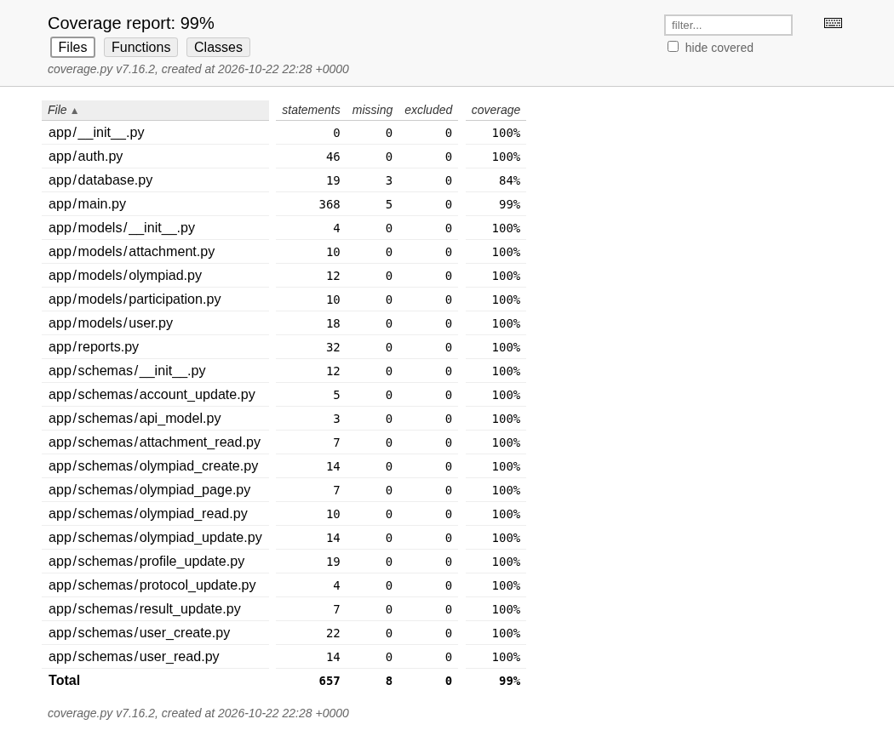

# Отчёт о тестировании

Проект: учёт участия студентов в олимпиадах. Версия: `simple-student`, первый
этап FastAPI, состояние после обязательных дополнений и повторной проверки 23.10.2026.
Тип отчёта: версионный. ФИО исполнителя при сдаче: __________________.
Основание: [план](TEST_PLAN.md) и [тест-кейсы](TEST_CASES.md).

## Среда и объём

Python 3.12.14, PostgreSQL 17.11 как отдельный процесс, FastAPI 0.115.12,
SQLAlchemy 2.0.41, pytest 8.4.1, pytest-cov 6.2.1, httpx 0.28.1.
Автотесты работали в отдельной `olympiads_simple_test` на 127.0.0.1:5433;
HTTP-сценарий — с отдельной `olympiads_simple_delivery` и Uvicorn на порту 8001.
Рабочая база основной версии не использовалась и не очищалась.

Проверены вход и JWT, профили, роли, CRUD олимпиад, обе версии, фильтры и страницы,
заявки, собственные результаты, ответственность преподавателей, цикл протокола,
создание/замена/удаление вложений, реальные DOCX/XLSX, годовой отчёт и данные.

## Результаты автоматизации

Повторный запуск: 23.10.2026 03:27:48 по Екатеринбургу. Длительность:
16,93 с по итоговой строке pytest (16,862 с в XML). Команда: `python -m pytest` с дополнительными параметрами
`--cov-report=json`, `--cov-report=html`, `--junitxml` для сохранения доказательств.

| Показатель | Фактическое значение |
| --- | --- |
| Собрано / успешно | 72 / 72 |
| Падений / ошибок / пропусков | 0 / 0 / 0 |
| Успешность набора | 100% |
| Покрытие строк `app` | 649 из 657, 98,78% |
| Покрытие `app/main.py` (маршруты и общие проверки) | 363 из 368, 98,64% |
| Требуемый минимум | 80%, достигнут |
| Учебные записи в четырёх таблицах | 50 / 50 / 50 / 50 |
| Повторная инициализация | Количества сохранены |

Инициализация `init_db.py` отдельно проверена тестом: все четыре сущности,
связи через FK, четыре вида документов и открытие 50 настоящих Word-файлов.
Она не включена в показатель покрытия пакета `app`, поэтому процент не относится
ко всему репозиторию. Фактический HTML-отчёт представлен на рисунке 1.

## Проверка через настоящий HTTP-сервер

Успешно выполнены логины трёх ролей; получение Swagger, ReDoc и схем обеих
версий; чтение 50 олимпиад; создание отдельной олимпиады; запись студента;
отклонение дубликата (409); ввод 95,5 балла; скрытие до публикации (404/null);
загрузка и открытие положения Word; подготовка и публикация; запрет публикации
преподавателю (403); скачивание протокола и годового отчёта в DOCX и XLSX.
Выгрузки повторно открыты библиотеками и проверено содержимое таблиц.
Проверочные записи удалены из отдельной проверочной базы после завершения.
Swagger проверен браузером; выполнен публичный GET из интерфейса.

## Дефекты и изменения

| ID | Важность | Воспроизведение в первоначальной простой версии | Ожидалось / наблюдалось | Исправление и факт |
| --- | --- | --- | --- | --- |
| B01 | Средняя | PUT карточки олимпиады в v1 и v2 от администратора | 200 / 405 | Добавлен полный PUT; обе проверки проходят |
| B02 | Высокая относительно функции изменения бланка | PUT загруженной грамоты по ID от ответственного | 200 и сохранение ID / 405 | Добавлена замена файла; номер сохранён, старый файл удалён, чужой преподаватель получает 403 |
| B03 | Средняя, соответствие методичке | Сопоставить первоначальный `init_db.py` с минимумом 50 записей на сущность | ≥50 / 3 пользователя, 2 олимпиады, 1 заявка, 0 документов | В новой пустой базе по 50 записей и 50 файлов; повтор безопасен |
| B04 | Средняя, воспроизводимость проверки | В первоначальной ветке отсутствовал каталог `tests` | Тесты в проекте / отсутствуют | Включён проверенный набор, dev-зависимости и обязательный порог покрытия |

Перед добавлением реализации были запущены четыре новые проверки:
два PUT карточки, PUT бланка и проверка наполнения. Все четыре завершились
неуспешно (в проверке наполнения отсутствовала необходимая функция `seed_demo`).
После реализации полный набор из 72 тестов прошёл. B01–B04 закрыты в данной версии.
Краткий баг-репорт также включён в приложение пояснительной записки по методичке.

Развитие v2: список с пагинацией, поиском, `total` и границами размера страницы.
Исправления прав и обязательных операций применены к обеим версиям; v1
намеренно не оставлена с дефектами.

## Заключение и пределы проверки

Блокирующих функциональных ошибок в выполненном наборе не обнаружено.
Проверенный сценарий первого этапа работает, обязательный минимум покрытия
достигнут. Один успешный прогон не доказывает многодневную стабильность:
нагрузочные испытания, внешнее размещение и Django/UI второго этапа не проводились.
История полностью последовательной разработки всего проекта по TDD не заявляется;
цикл падающих и успешных тестов подтверждён для обязательных дополнений.

## Повторная сверка API после всех дополнений

Проверены все R01–R19 из [матрицы требований](TEST_PLAN.md#матрица-трассировки)
по персональному ТЗ и обязательным техническим пунктам методички первого этапа.
Обязательные функции API присутствуют; обнаруженные пропуски B01–B04 устранены.

Дополнительный итоговый сценарий через настоящий HTTP-сервер подтвердил:

- создание студента со всеми полями ТЗ, вход, изменение профиля и запрет повышения роли;
- запись одного студента на две разные олимпиады и наличие обеих собственных заявок;
- положение, две грамоты одной олимпиады, замену грамоты по ID и разграничение преподавателей;
- скрытие текущего задания и доступность прошлогоднего;
- ввод баллов, подготовку, запрет правок, отзыв подготовленного протокола,
  повторную подготовку, публикацию только администратором и открытие собственных результатов.

После удаления временных проверочных записей в проверочной базе осталось ровно
50 пользователей, 50 олимпиад, 50 заявок и 50 документов. Ссылки руководств
проверены; содержание 60-страничной записки сверено с фактической пагинацией PDF.
В DOCX оставлено обновляемое поле содержания. Перед печатью нужно заполнить
точную группу, номер студенческого, обозначение проекта, ФИО руководителя и подписи.

## Повторная проверка пояснительной записки по исходным документам

Основание: персональное ТЗ «Пеннер (1).pdf», разделы 2.2–2.8 и 3 методички
КП 2026, отдельный файл общих правил оформления и предоставленный бланк рамок.
Проверка относится к API первого этапа. Самостоятельные руководства и тестовые
документы сохранены; непосредственно в записку включены материалы, требуемые
её структурой. В предыдущей версии часть этих требований была пропущена.

| Пункт исходных требований | Результат повторной проверки / исправление |
| --- | --- |
| Методичка 2.2, 2.3: титул и структура | Обязательные части есть; тема, колледж, ФИО автора и 2026 год соответствуют ТЗ. Непредоставленные реквизиты оставлены пустыми |
| Методичка 2.4, бланк ведомости | Восстановлены семь столбцов, количество листов и технический штамп с автором |
| Методичка 2.5: автоматическое содержание | Поле TOC уровней 1–3; номера проверены по итоговому PDF |
| Методичка 2.6: введение | Названы тема, актуальность, объект, предмет, цель и четыре задачи первого этапа |
| Методичка 2.7.1–2.7.4: анализ и архитектура | Описаны предметная область, четыре роли, права, модули и взаимодействие частей; есть диаграмма вариантов использования |
| Методичка 2.7.5: тестовая документация | В разделе 2.5 размещены реестр R01–R19, Test Plan, матрица трассировки, тестовые данные и TC01–TC14; ссылки на отдельные документы сохранены |
| Методичка 2.8.1: стек | Сверен с установленными пакетами и фактическим запуском Python/PostgreSQL без Docker |
| Методичка 2.8.2: физическая модель | ERD сформирована по настоящей PostgreSQL; четыре таблицы и их связи совпадают с ORM |
| Методичка 2.8.2: словарь данных | Шесть столбцов по образцу; проверены все 32 поля, типы, NULL, дополнительные ограничения и назначение |
| Методичка 2.8.3: отдельный файл для класса | Исправлено: каждый из 17 классов имеет собственный файл; поведение API сохранено |
| Методичка 2.8.3: структура и фикстуры | В записке описаны все классы, папки и семь фикстур, их область действия и очистка |
| Методичка 2.8.4: алгоритмы | Есть схемы записи, переходов протокола и проверки JWT/прав |
| Методичка 2.8.5: API | Таблица операций сверена с OpenAPI; добавлены непосредственно в записку примеры форм, JSON, ответов, ошибок и выгрузок |
| Методичка 2.8.5: установка | Указаны команды, две базы, .env, секрет, инициализация, запуск и тесты; добавлен фактический снимок проверки PostgreSQL и данных |
| Методичка 2.8.6: отчёт | Заголовок, область, метрики, дефекты, результат и пределы проверки включены в раздел 3.6 |
| Методичка 2.8.7: глоссарий | Есть термины и используемые сокращения |
| Методичка 2.8.8: библиография | Формальный состав проверен: 25 источников, из них 10 книг и 10 публикаций периодики; ссылки 1–25 соответствуют списку. Сведения об одной статье уточнены |
| Методичка 2.8.9: заключение | Выводы связаны с целью, реализацией API и измеренными результатами |
| Методичка 2.8.10, 3.4: приложения | Баг-репорт и примеры работы вынесены в нумерованные приложения; заголовки и ссылки исправлены |
| Отдельные правила 3.1: объём и поля | Итоговый PDF — 60 страниц A4; поля 3 / 1,5 / 2 / 2,5 см; сквозные номера с введения |
| Отдельные правила 3.1: шрифт | Основной текст DOCX — Times New Roman 14 пт; настоящий Times New Roman встроен в PDF. Подмена на Liberation Serif устранена |
| Отдельные правила 3.2–3.3: рисунки и таблицы | Проверены подписи, ссылки, нумерация 11 рисунков и 15 таблиц; для частей таблиц повторены шапки и добавлены подписи продолжений |
| Согласованность с кодом | Проверены маршруты, названия файлов и классов, поля БД, сценарии, показатели покрытия и местные ссылки |

После изменения структуры повторно прошли все 72 теста. Через настоящий сервер
повторены профиль, запись на две олимпиады, положения и несколько грамот,
замена бланка, разграничение преподавателей, подготовка/отзыв/публикация.
В проверочной базе сохранены по 50 записей на сущность. Генераторы документов,
проверочные сценарии подготовки и установленные для экспорта шрифты в репозиторий
не добавлены.

### Данные и противоречия, которые нельзя считать автоматически закрытыми

- Точная группа, номер студенческого, обозначение проекта, ФИО руководителя,
  ФИО ответственного за сдаваемый отчёт, подписи и оценка не предоставлены.
  Они оставлены полями для фактического заполнения; чужие данные из шаблона не перенесены.
- В методичке, раздел 3.1, указан размер 12 пт, а в отдельном файле общих правил,
  раздел 3.1, — 14 пт. Применён размер 14 пт из специального файла оформления.
  Одновременное выполнение двух противоречащих размеров невозможно.
- Полная история разработки всего проекта по TDD не подтверждена. Подтверждён
  цикл падающих и успешных тестов обязательных дополнений; история не подделывалась.
- Для библиографии проверены формальный состав, выходные данные и внутренние
  ссылки; полное прочтение всех книг и внешняя полнотекстовая проверка всех
  публикаций в ходе этой проверки не заявляются.

Финальный контроль: 117 проверок структуры и согласованности пройдены.
Проверены все номера содержания и страниц итогового PDF. Широкий Test Plan
размещён на трёх альбомных листах A4 по разрешению п. 3.3 правил оформления;
поля и сквозная нумерация сохранены.
