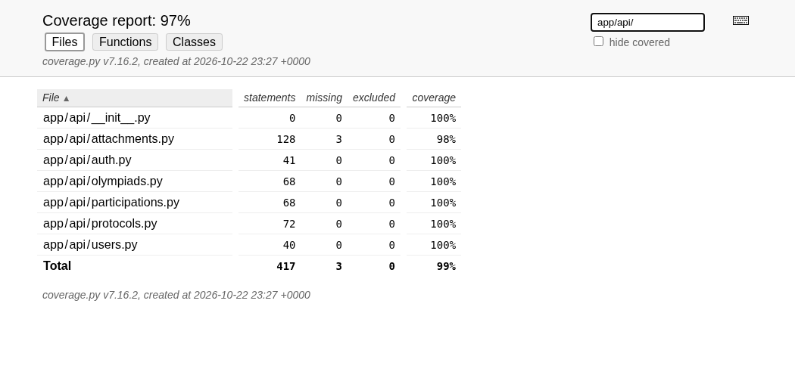

# Отчёт тестирования первого этапа API

## Информационный заголовок

Проект EMK-API-2026 (OLYMPIADS-REST), основная ветка `main`, сборка 1.0.0.
Тип отчёта — версионный. Начало автопрогона: **23.10.2026 04:26:47 (Екатеринбург)**,
UTC: `2026-10-22T23:26:47.677538+00:00`. Исполнитель автоматического запуска — среда разработки.
ФИО студента: Пеннер Андрей Владимирович. ФИО тестировщика при сдаче:
__________________. Приёмка руководителем не проводилась.

## Объём и результат

Проверены JWT/роли, профиль и аккаунты, CRUD олимпиад, фильтр и пагинация,
заявки, ответственность преподавателя, результаты, подготовка/отзыв/публикация,
файлы, бланки и настоящие Word/Excel. База — обычная PostgreSQL 17.11,
Python 3.12.14; контейнеры и SQLite не использовались.

**78 тестов прошли; ошибок, падений и пропусков — 0.**
Успешность выбранного набора — 100%. Время по JUnit — **35.488 с**,
в консольном отчёте — 35,51 с. Предыдущий контрольный прогон: 75 тестов;
добавлены тест наполнения/повторной инициализации и две контрактные проверки OpenAPI.

| Область покрытия | Строки | Покрытие |
|---|---|---|
| Весь пакет app | 874 / 903 | 96.79% |
| app/api | 414 / 417 | 99.28% |
| app/services.py | 28 / 28 | 100% |

Порог методички §2.7.5 — 80% роутов и сервисов — достигнут. Пакет app включает
начальное наполнение; клиент client/ и установочные scripts/ не входят в
знаменатель. Неисполненные строки находятся в следующих модулях:

| Модуль | Неисполненные строки |
|---|---|
| `app/api/attachments.py` | 71, 72, 73 |
| `app/database.py` | 11, 18, 19 |
| `app/init_db.py` | 80, 81, 82, 83, 84, 90, 91, 92, 93, 94, 95, 96, 97, 98, 99, 100, 101, 102, 103, 104, 106, 110 |
| `app/main.py` | 26 |



План, перечень 19 требований и двумерная матрица: [TEST_PLAN.md](TEST_PLAN.md).
Предусловия, шаги, ожидания и связи с функциями автотестов:
[TEST_CASES.md](TEST_CASES.md). Те же обязательные таблицы и сценарии включены
в §2.5 пояснительной записки. Сценарии TC01–TC14 группируют проверки,
параметризация разворачивает их в 78 запусков.

## Изоляция и фикстуры

| Фикстура | Назначение / scope | Очистка |
|---|---|---|
| test_engine | Отдельная PostgreSQL с суффиксом _test; session | dispose |
| db | Внешняя транзакция, Session с savepoint; function | rollback внешней транзакции |
| client | TestClient, override get_db у обоих API, временное хранилище; function | Закрытие клиента и очистка overrides |
| password_hash | Хеш TestPass2026!; session | Только память процесса |
| accounts | admin, два teacher, два student; function | Откат через db |
| headers | JWT-заголовки пяти пользователей; function | Только память |
| olympiad | Событие на сегодня для teacher; function | Откат через db |

Набор содержит успешные запросы и ошибки паролей, JWT, ролей, обязательных
полей, дат, состояний, повторных записей и файлов. Проверяются коды и данные,
а экспорт открывается python-docx/openpyxl. `test_demo_records_and_repeat`
проверяет 111 пользователей, 50 олимпиад, 150 заявок, 200 реальных DOCX,
все четыре вида документов и отсутствие изменений при повторном seed_demo.
Хеширование паролей не подменяется.

## Проверка настоящего HTTP-сервера

Повторный сценарий выполнен через Uvicorn на 127.0.0.1:8001 в отдельной базе
olympiads_main_delivery. Созданы временный студент и две олимпиады:

1. Преподаватель создал студента со всеми полями ТЗ; студент вошёл и изменил профиль.
2. Студент записался на две олимпиады, обе заявки появились в собственном списке.
3. Прикреплены положение и две грамоты, грамота заменена по ID; DOCX открыт.
4. Задание текущего года скрыто; после перевода события в прошлый год доступно.
5. Чужой преподаватель получил 403; ответственный ввёл 95,5 балла.
6. До публикации результат скрыт; подготовка запрещает правки; отзыв разрешает
   вернуться к черновику; публикация доступна администратору.
7. Гость и студент получили опубликованный результат; протокол и годовой отчёт
   скачаны в обоих форматах и повторно открыты библиотеками.
8. Swagger v1/v2 открыт браузером, выполнен GET; ReDoc v1/v2 отрисован.

Временные записи удалены из отдельной проверочной базы. В ней осталось
ровно 111/50/150/200 записей. Рабочая база olympiads не изменялась.
Существующий scripts.smoke остаётся для самостоятельного повторения на учебных
данных; он сохраняет собственный пример и выгрузки в исключённую из Git reports/.

## Воспроизведение

После обычной установки по README и настройки отдельной тестовой базы:

```bash
python -m pytest -q --cov=app --cov-fail-under=80 --cov-report=term-missing --cov-report=html:reports/tests/coverage --cov-report=json:reports/tests/coverage.json --junitxml=reports/tests/junit.xml
```

Покрытие измеряется параметрами команды; обычный pytest без них не измеряет его.
Плановый порядок: JWT/права → CRUD/версии → заявки/протокол → файлы/экспорт →
наполнение → регрессия. Критерии начала и окончания указаны для каждого TC в плане.

## Реестр обнаруженных проблем

| ID | Проблема | Важность | Шаги и факт | Исправление / статус |
|---|---|---|---|---|
| B01 | При прямом добавлении маршрутов v2 не применялась подмена get_db | Средняя | test_v2_security_and_write: ожидалось 201, получено 401 | Общий APIRouter включён через include_router; закрыт |
| B02 | Несовместимая транзитивная Pydantic вызывала предупреждения | Низкая | UnsupportedFieldAttributeWarning при первом прогоне | Зафиксирована совместимая Pydantic 2.11.7; закрыт |
| E01 | Фикстура подменяла БД только корневого приложения | Средняя | Защищённые запросы 401 и пустой список | Override настроен у обоих API; закрыт |
| D02 | Обобщённые ответы OpenAPI и неверный тип скачивания в схеме | Средняя | Протоколы/заявки без полей, скачивание заявлено JSON | Добавлены явные модели, схемы ошибок и бинарные типы; v1/v2 проверены; закрыт |
| D01 | Неполные обязательные таблицы и формальное оформление записки | Средняя | Сверка §2.7.5, §2.8.2 и §2.8.8 с прежним DOCX/PDF | Исправлены ведомость, план, матрица, словарь, классы/фикстуры, источники и PDF; закрыт |

D02 исправлен при текущей проверке, HTTP-формат ответов сохранён.
B01/B02/E01 перенесены из предыдущего отчёта, это исторические наблюдения,
а не новые падения нынешнего набора. Не создавались вымышленные ошибки логики.
v2 добавляет поиск/пагинацию; исправления общих маршрутов действуют и для v1.

## Повторная сверка обязательных требований

| Основание | Результат |
|---|---|
| Персональное ТЗ: гость, студент, преподаватель, администратор | Права, профиль, несколько заявок, протоколы и отчёты проверены |
| Персональное ТЗ: создание положения и любое число бланков, изменение | templates, attachments POST/PUT; несколько грамот и права проверены |
| Методичка §2.7.5: реестр, Test Plan из 6 граф, матрица, данные, тест-кейсы | Есть в §2.5 записки и отдельных TEST_PLAN/TEST_CASES |
| §2.8.2: физическая ERD и словарь из 6 граф | Все 32 поля, типы/NULL/ключи сверены с PostgreSQL |
| §2.8.3: один класс в файле, описание файлов и каждой фикстуры | 25 классов в отдельных файлах; описаны все 7 фикстур |
| §2.8.4: блок-схемы алгоритмов | Запись, состояния протокола и проверка JWT |
| §2.8.5: v1/v2, GET/POST/PUT/PATCH/DELETE, JWT, Swagger/ReDoc | 32 операции каждой версии, актуальные OpenAPI и примеры в записке |
| §2.8.5: установка и подключение БД со снимками | Пошаговые команды, фактический вывод подключения и снимки API |
| §2.8.6: заголовок, метрики, реестр, вывод, время, скриншоты | Есть в §3.6 и данном отчёте; ограничения обозначены |
| §2.8.8: 20–25 источников, ≥10 книг и 10–15 периодических материалов | 25 записей: 10 книг, 10 статей, 5 исходных/нормативных/электронных материалов; ссылки 1–25 |
| Правила §3.1–3.4: 40–59 страниц, поля, нумерация, таблицы, приложения | 59 страниц A4; Times New Roman 14, шрифт встроен в PDF; сквозная нумерация и обновляемое содержание |
| Только первый этап | Django и его UI-тесты не добавлялись |

## Вывод и ограничения

Проверенный набор не выявил блокирующих функциональных ошибок API первого этапа.
Известные недочёты документации исправлены. Реальные группа, студенческий номер,
обозначение проекта, ФИО руководителя и подписи не предоставлены: оставлены поля.
Методичка требует 12 пт, отдельные правила оформления — 14 пт; выбран размер 14
по специальному документу. Это противоречие нужно согласовать при сдаче.

Полная историческая последовательность TDD не подтверждена; тесты не выданы
за доказательство её соблюдения. Проверены состав и ссылки библиографии;
прочтение всех полных текстов книг/статей автором не подтверждается.
Нагрузка, многодневная стабильность, промышленная эксплуатация и Django
не проверялись. Два успешных контрольных прогона подтверждают повторяемость
этого набора в данной среде, но не заменяют длительные испытания.
